# How the database works

The app keeps everything in one SQLite file ([ADR 0002](../adr/0002-database.md)). The tables are described in `src/lib/server/db/schema.ts`. This page explains how they fit together.

## Tables

| Table | What a row is |
| --- | --- |
| `family` | One family. Everything else belongs to one. |
| `user` | A grown-up who signs in with Google. |
| `invite` | A Google email invited to join a family ([grown-ups.md](grown-ups.md)). |
| `session` | One signed-in device (the id is a hash of the cookie token). |
| `child` | A child in a family. |
| `child_photo` | The photo in a child's rocket window ([photos.md](photos.md)). |
| `chore_photo` | A grown-up's own photo for a chore. |
| `reward_photo` | A grown-up's own photo for a reward. |
| `child_passcode` | A child's optional picture passcode, as a hash ([children.md](children.md)). |
| `child_unlock` | A passcode trip open on one device. |
| `star_event` | One change to a child's stars. |
| `chore` | A chore in the family's library. |
| `chore_copy` | One child's copy of a chore, with its own status. |
| `chore_reset` | One daily reset that ran for a family ([reset.md](reset.md)). |
| `reward` | A reward in the family's library ([rewards.md](rewards.md)). |
| `reward_child` | One child a reward is for. |
| `reward_claim` | A child asking for a reward, and the grown-up's answer ([claims.md](claims.md)). |
| `pin_reset` | An emailed code for setting a new PIN ([recovery-email.md](recovery-email.md)). |
| `checked_notice` | A "checked!" message waiting to show on a child's trip ([checking.md](checking.md)). |

## Diagram

Each box is a table, showing only its main columns. A line means the table on the "many" side holds the id of the other, and deleting the parent row deletes the rows that depend on it.

To keep this readable, a table with another parent does not also get a line to `family`. It still has its own `family_id`, as the next section explains.

```mermaid
erDiagram
    family ||--o{ user : "has"
    family ||--o{ child : "has"
    family ||--o{ chore : "has"
    family ||--o{ reward : "has"
    family ||--o{ invite : "sends"
    family ||--o{ pin_reset : "requests"
    family ||--o{ email_verification : "requests"
    family ||--o{ chore_reset : "records"

    user ||--o{ session : "signs in on"
    session ||--o{ grownup_token : "unlocks with"
    session ||--o{ child_unlock : "has open"

    child ||--o{ star_event : "earns and spends"
    child ||--o{ chore_copy : "gets"
    child ||--o{ reward_child : "is listed in"
    child ||--o{ reward_claim : "makes"
    child ||--o{ checked_notice : "is shown"
    child ||--o{ child_unlock : "is opened by"
    child ||--o| child_passcode : "may have"
    child ||--o| child_photo : "may have"

    chore ||--o{ chore_copy : "is copied to"
    chore ||--o| chore_photo : "may have"
    chore_copy ||--o{ checked_notice : "leads to"
    reward ||--o{ reward_child : "is for"
    reward ||--o| reward_photo : "may have"
    reward ||--o{ reward_claim : "is asked for in"

    family {
        int id PK
        text name
        text pin_hash
        int version
    }
    user {
        int id PK
        int family_id FK
        text role
        text email
    }
    session {
        text id PK
        int user_id FK
        int expires_at
    }
    grownup_token {
        text id PK
        int family_id FK
        text session_id FK
        int expires_at
    }
    invite {
        int id PK
        int family_id FK
        text email
        int expires_at
    }
    pin_reset {
        int id PK
        int family_id FK
        text code_hash
        int expires_at
    }
    email_verification {
        int id PK
        int family_id FK
        text email
        text token_hash
    }
    child {
        int id PK
        int family_id FK
        text name
        text colour
    }
    child_passcode {
        int child_id PK, FK
        int family_id FK
        text hash
        int fails
    }
    child_photo {
        int child_id PK, FK
        int family_id FK
        blob data
        int version
    }
    child_unlock {
        text session_id PK, FK
        int child_id PK, FK
        int family_id FK
        int expires_at
    }
    star_event {
        int id PK
        int family_id FK
        int child_id FK
        text kind
        int amount
    }
    chore {
        int id PK
        int family_id FK
        text name
        int stars
    }
    chore_photo {
        int chore_id PK, FK
        int family_id FK
        blob data
        int version
    }
    reward_photo {
        int reward_id PK, FK
        int family_id FK
        blob data
        int version
    }
    chore_copy {
        int id PK
        int family_id FK
        int chore_id FK
        int child_id FK
        text status
    }
    chore_reset {
        int id PK
        int family_id FK
        text chore_day
        int copies_reset
    }
    checked_notice {
        int id PK
        int family_id FK
        int child_id FK
        int copy_id FK
        int stars
    }
    reward {
        int id PK
        int family_id FK
        text name
        int cost
    }
    reward_child {
        int id PK
        int family_id FK
        int reward_id FK
        int child_id FK
    }
    reward_claim {
        int id PK
        int family_id FK
        int reward_id FK
        int child_id FK
        text status
    }
```



When a change adds a table or a link, update this diagram in the same commit.

## How tables link: `family_id`

A table that belongs to a family has a `family_id` column. It holds the `id` of a row in `family`.

`family`

| id | name |
| --- | --- |
| 1 | Ours |
| 2 | Theirs |

`child`

| id | family_id | name |
| --- | --- | --- |
| 1 | 1 | Mia |
| 2 | 1 | Leo |
| 3 | 2 | Sam |

Mia and Leo have `family_id` 1, so they belong to the family with `id` 1.

In `schema.ts` this is:

```ts
familyId: integer('family_id')
  .notNull()
  .references(() => family.id, { onDelete: 'cascade' }),
```

- `familyId` is the name in the code. `family_id` is the column in the database. They are the same column.
- `notNull()`: every row must belong to a family.
- `references(() => family.id)`: the database refuses a `family_id` that is not a real family.
- `onDelete: 'cascade'`: deleting a family deletes everything that belongs to it.

The database only checks that the family exists. It does not stop one family reading another's rows. That is done in code (next section).

## One family cannot see another's data

Every read and write goes through `forFamily(db, familyId)` in `src/lib/server/family.ts`. Build it from the signed-in grown-up's family, and it can only reach that family's rows:

```ts
const scope = forFamily(db, locals.user.familyId);
scope.children();        // only this family's children
scope.child(3);          // null if child 3 is in another family
```

- Do not query a family table directly. Go through the scope, or use `scope.where(table, ...)` to add the family filter.
- A child, or anything else, from another family looks like it does not exist.
- `src/lib/server/stars.test.ts` has tests that one family cannot add, read, undo or move another family's stars.

## Stars

A child's stars are never stored as a number ([ADR 0003](../adr/0003-data-model-for-stars.md)). Each change is a row in `star_event`, and the balance is the sum of the child's rows.

| kind | amount | when |
| --- | --- | --- |
| `chore` | positive | a grown-up accepts a chore |
| `bonus` | positive | every stop for the day is done |
| `reward` | negative | a grown-up hands out a reward (`source_id` is the claim, [claims.md](claims.md)) |

- `source_id` says which chore copy or reward claim a row came from. For a `bonus` row it is the chore day as a number (`20261117`), so a day can only have one ([daily-bonus.md](daily-bonus.md)).
- **Undoing an accepted chore** deletes the one row the accept added, by its id (`chore_copy.star_event_id`), because a daily chore's copy collects a row every day. **"That wasn't Mia"** writes the row for the right child instead ([checking.md](checking.md)). The log shows only what stands, which is what the grown-ups' star history reads ([ranks.md](ranks.md)).
- Each row keeps the stars at the time, so editing a chore's value later does not change past stars.
- The rank comes from the current balance, in `src/lib/ranks.ts` (Cadet 0, Pilot 50, Explorer 100, Captain 250, Commander 500). A rank can drop after a reward.
- Only the functions in `src/lib/server/stars.ts` change stars. Do not write to `star_event` anywhere else.

## The grown-up PIN

The family's shared PIN is in `family.pin_hash`, never as the PIN itself ([ADR 0007](../adr/0007-pin-and-grown-up-mode.md)).

- `src/lib/server/pin.ts` turns the PIN into a salted scrypt hash (`scrypt$<salt>$<hash>`) and checks a PIN against it.
- `pin_fails`, `pin_lock_stage` and `pin_locked_until` count wrong PINs for the whole family and lock the pad (`src/lib/server/grownup.ts`). The right PIN resets them.
- `grownup_token` has one row per device in grown-up mode: a hash of the token the page keeps in memory, the device's session, and when it stops working. Signing the device out deletes it.
- `pin_hash` is empty until setup step 2. While it is empty, setup is open; once it is set, the setup pages refuse (`src/lib/server/setup.ts`), so they cannot be used to replace the PIN.

## Recovery email and alerts

- **`family.recovery_email`** is set only when someone opens the confirm link and presses Confirm (`src/lib/server/recovery-email.ts`). Until then the address waits in `email_verification`.
- **`email_verification`** has one row per confirm link sent. It keeps a hash of the link's token, never the token. A link works once, for 24 hours, and a newer link cancels older ones. Rows are kept after use so a family can be limited to 5 links an hour.
- **`family.ntfy_topic`** is the family's secret alert topic: `rocket-` and 12 random letters and digits. Families made earlier may have 32 random characters, which still work (`src/lib/server/alerts.ts`).
- **`family.setup_done_at`** is set by Finish on setup step 4. While it is empty, `/` sends the family to their setup step.

## Live updates: `family.version`

Screens on other devices refresh when the family's data changes (ADR 0006). The signal is one number, `family.version`:

- **Triggers bump it.** Every insert, update or delete on `child`, `chore`, `chore_copy`, `star_event`, `reward`, `reward_child` or `reward_claim` adds 1 to that row's family's `version` (migrations `0010`, `0013` and `0015`). Adding or removing a `child_passcode` does too (`0019`), and so does any change to a photo table (`0021`, `0022`). No code has to remember to do it, so new features get live updates for free.
- **Screens poll it.** `GET /api/changes` returns the signed-in family's version (`src/lib/server/live.ts`). Details are in [live-updates.md](live-updates.md).
- Only the changed family's number moves, so one family's activity never makes another family's screens reload.

## Migrations: how the tables get built

The files in `drizzle/` (`0000_…sql`, `0001_…sql`, `0002_…sql`) are steps, run one after another. Each one only describes what changed since the one before, so they do not repeat each other.

- `0000` creates the first tables (`family`, `user`, `session`).
- `0001` is the next change to them.
- `0002` adds `child` and `star_event`.
- `0003` adds each child's rocket `colour` and the family's `pin_hash`.
- `0004` adds the family's `recovery_email`, `ntfy_topic` and `setup_done_at`, and the `email_verification` table.
- `0005` adds the family's wrong-PIN count (`pin_fails`, `pin_lock_stage`, `pin_locked_until`) and the `grownup_token` table.
- `0006` adds `chore` and `chore_copy`.
- `0007` adds each chore's repeat (`repeat_kind` and the `repeat_…` columns) and the `chore_reset` table.
- `0008` adds each chore's `expectations` (what done looks like, shown on the stop).
- `0009` adds `done_at` to `chore_copy` (when the child tapped "I did it!") and the family's `version`.
- `0010` adds the triggers that bump `family.version` (see "Live updates" below). It was written by hand with `npx drizzle-kit generate --custom`, because Drizzle cannot describe triggers in `schema.ts`.
- `0011` adds `checked_at`, `star_event_id` and `message` to `chore_copy`, and the `checked_notice` table.
- `0012` adds the `reward` and `reward_child` tables.
- `0013` adds the triggers that bump `family.version` for them. Written by hand, like `0010`.
- `0014` adds the `reward_claim` table, with a partial unique index so a child has one waiting claim per reward.
- `0015` adds the version triggers for it. Written by hand, like `0010`.
- `0016` adds `hidden`, `skip_until` and `skip_open` to `chore` ([skip-hide.md](skip-hide.md)).
- `0017` adds the `pin_reset` table ([recovery-email.md](recovery-email.md)).
- `0018` adds the family's settings ([settings.md](settings.md)).
- `0019` adds `child_passcode` and `child_unlock`, with triggers so turning a passcode on or off bumps the family's version ([children.md](children.md)).
- `0020` adds the `invite` table ([grown-ups.md](grown-ups.md)).
- `0021` adds `child_photo`, with triggers that bump the family's version ([photos.md](photos.md)).
- `0022` adds `chore_photo` and `reward_photo`, with the same triggers.

Nothing combines them into one file. Running them in order builds the whole database.

- **`schema.ts` is the combined picture.** It describes the tables as they are after every step. When you change it, `npm run db:generate` compares it with the last snapshot and writes only the difference as the next file.
- **On start, the app runs only the steps it has not run yet.** It reads the list in the database's `__drizzle_migrations` table, runs the missing files in order, and records them. A new empty database runs all of them. The live database runs only the new ones.
- **Never edit a step that has been deployed.** The live database is already past it. Make a new step instead.
- `drizzle/meta/_journal.json` lists the steps in order, and the `00NN_snapshot.json` files record what the schema looked like at each step. `npm run db:generate` writes them, so do not edit them by hand.
- Joining all the steps into one fresh `0000` is only safe before any real data exists. Do not do it now that the app is live.

To add a step, follow [migrations.md](../how-to/migrations.md).
